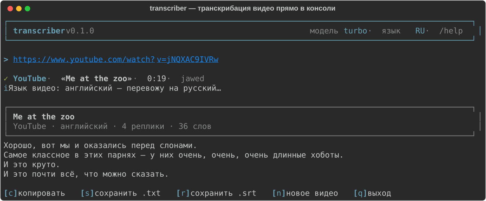

# transcriber

**Консольный транскрибатор видео: вставляешь ссылку — получаешь текст.**

Скачивает аудио с YouTube, Shorts, TikTok, Instagram и сотен других площадок, распознаёт речь локально (без API-ключей и без облаков) и при необходимости переводит на русский или английский. Готовый текст сразу в консоли — копируй, сохраняй в `.txt` или `.srt`.


## Возможности

- 🔗 **Одна строка на входе** — просто вставь ссылку на видео
- 🎬 **YouTube, Shorts, TikTok, Instagram, X/Twitter, VK, Rutube, Facebook, Reddit, Vimeo, Twitch** и другие площадки, которые умеет yt-dlp (1000+ сайтов)
- 🎯 **Локальное распознавание** через faster-whisper — бесплатно, приватно, без API-ключей
- 🌍 **Автоопределение языка** видео: русское видео → русский текст, английское → английский
- 🔁 **Перевод по требованию**: если язык видео не совпадает с выбранным, текст переводится (ru ↔ en и другие языки)
- 📋 **Копирование в буфер обмена** одной клавишей `c`
- 💾 **Экспорт**: `.txt` и `.srt` (субтитры с таймингами, в том числе переведённые)
- 🕘 **История расшифровок** — `/history`, можно вернуться к любой записи
- 🖥️ **Минималистичный консольный интерфейс** в духе современных CLI-агентов: баннер, прогресс-бары, меню

## Как это выглядит



*(живое демо — `docs/demo.svg`, если картинка не отобразилась в клиенте)*

```
╭─────────────────────────────────────────────────────────────────╮
│ transcriber v0.1.0              модель turbo · язык RU · /help  │
╰─────────────────────────────────────────────────────────────────╯

> https://www.youtube.com/watch?v=jNQXAC9IVRw

✓ YouTube · «Me at the zoo» · 0:19 · jawed
ℹ Язык видео: английский — перевожу на русский…

╭─────────────────────────────────────────────────────────────────╮
│ Me at the zoo                                                   │
│ YouTube · английский · 4 реплик · 36 слов                       │
╰─────────────────────────────────────────────────────────────────╯
Хорошо, вот мы и оказались перед слонами.
Самое классное в этих парнях — у них очень, очень, очень длинные хоботы.
И это круто.
И это почти всё, что можно сказать.

[c] копировать  [s] сохранить .txt  [r] сохранить .srt  [n] новое видео  [q] выход
```

## Быстрый старт

Нужен [uv](https://docs.astral.sh/uv/) — остальное он поставит сам (Python, зависимости, модели).

```bash
git clone https://github.com/xghostyyy/transcriber.git
cd transcriber
uv run transcriber
```

Хочешь команду `transcriber` из любой папки:

```bash
uv tool install .
transcriber
```

### Ярлык на рабочий стол (Windows)

```powershell
powershell -ExecutionPolicy Bypass -File scripts/install_shortcut.ps1
```

На рабочем столе появится ярлык **«Транскрибатор»** с фирменной иконкой — двойной клик, и можно сразу вставлять ссылку. Иконку при желании можно перерисовать: `scripts/make_icon.ps1`.

> **Первый запуск.** Модель `turbo` (~1,6 ГБ) скачается автоматически один раз и закэшируется. `ffmpeg` ставить не нужно — всё декодируется встроенными библиотеками.

## Использование

**Интерактивный режим** (основной):

```bash
uv run transcriber
```

**Одноразовый режим** — сразу ссылка и нужные параметры:

```bash
uv run transcriber "https://youtu.be/..." --lang en --out transcript.txt
uv run transcriber "https://www.tiktok.com/@user/video/123..." --lang ru --copy
```

### Команды в интерактивном режиме

| Команда            | Что делает                                                       |
| ------------------ | ---------------------------------------------------------------- |
| `/help`            | справка                                                          |
| `/model [размер]`  | показать или сменить модель Whisper (`/model small`)             |
| `/lang [ru\|en]`   | показать или сменить язык результата (`/lang en`)                |
| `/history`         | последние расшифровки: открыть, скопировать, сохранить           |
| `/quit`            | выход                                                            |

### Флаги командной строки

| Флаг                        | Что делает                                        |
| --------------------------- | ------------------------------------------------- |
| `--lang ru\|en`             | язык результата                                   |
| `--model`                   | модель Whisper (`tiny`, `base`, `small`, `medium`, `large-v3`, `turbo`) |
| `--out ФАЙЛ`                | сохранить в `.txt` или `.srt`                     |
| `--copy`                    | скопировать результат в буфер обмена              |
| `--cookies-from-browser`    | взять cookies из браузера (`chrome`, `edge`, `firefox`, `brave`) — для приватных видео |
| `--keep-audio`              | не удалять скачанное аудио                        |
| `--output-dir ПАПКА`        | куда складывать сохранённые файлы (по умолчанию `./output`) |

### Модели

| Модель     | Размер  | Когда выбирать                                  |
| ---------- | ------- | ----------------------------------------------- |
| `turbo`    | ~1.6 ГБ | по умолчанию: лучшее качество на скорость       |
| `small`    | ~0.5 ГБ | если хочется поэкономичнее и побыстрее на CPU   |
| `medium`   | ~1.5 ГБ | классическая золотая середина                   |
| `large-v3` | ~3.1 ГБ | максимальное качество (медленно на CPU)         |
| `tiny` / `base` | ~75/145 МБ | черновые проверки                          |

GPU (NVIDIA) подхватывается автоматически; если CUDA-библиотек нет, программа сама переключится на CPU.

## Поддерживаемые площадки

yt-dlp закрывает 1000+ сайтов, в том числе:

**YouTube** (+ **Shorts**) · **TikTok** · **Instagram Reels** · **X / Twitter** · **VK** · **Rutube** · **Facebook** · **Reddit** · **Vimeo** · **Twitch (VOD)** · **Dailymotion** · **SoundCloud** · **Pinterest** · **LinkedIn** · **Telegram** и другие.

Приватные и закрытые видео иногда требуют cookies браузера — см. `--cookies-from-browser`.

## Как это работает

1. **yt-dlp** вытаскивает метаданные и лучшую аудиодорожку во временную папку
2. **faster-whisper** (CTranslate2) распознаёт речь локально и определяет язык
3. Если язык видео ≠ выбранному — текст переводится через публичный эндпоинт Google (два эндпоинта с автоматическим фолбэком)
4. Результат печатается в консоль, а запись попадает в историю

После работы аудио удаляется автоматически (если не указан `--keep-audio`).

## Где хранится всё

| Что              | Где                                              |
| ---------------- | ------------------------------------------------ |
| Настройки        | `~/.config/transcriber/config.toml`              |
| История          | `~/.config/transcriber/history/*.json`           |
| Модели Whisper   | `~/.cache/huggingface/hub`                       |
| Сохранённые файлы| `./output/` (или `--output-dir`)                 |

## Решение проблем

- **«Видео приватное или требует входа»** — запусти с `--cookies-from-browser chrome` (браузер должен быть залогинен).
- **Долго распознаёт на CPU** — возьми модель полегче: `/model small`. Или просто дождись: `turbo` на CPU обрабатывает примерно 1–3 минуты на каждые 10 минут видео.
- **Кракозябры вместо русского** — используй современный терминал (Windows Terminal, PowerShell 7); программа сама переключает вывод в UTF-8.
- **Google временно ограничил перевод (429)** — повтори позже; приложение уже пробует резервный эндпоинт и делает несколько попыток.

## Тесты

```bash
uv run pytest
```

Покрыта ключевая логика без сети и тяжёлых моделей: нарезка текста для перевода, батч-перевод субтитров с маркерами, фолбэк эндпоинтов Google, экспорт SRT, история, настройки и понятные ошибки yt-dlp. Тесты уже поймали один живой баг — экранирование Windows-путей в конфиге.

## Лицензия

[MIT](LICENSE) © xghostyyy. Уважай авторов видео и условия площадок.
